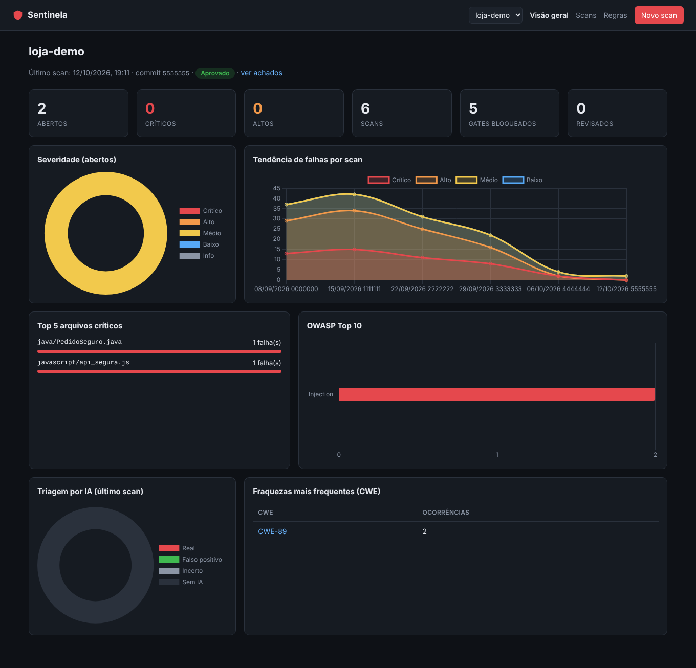
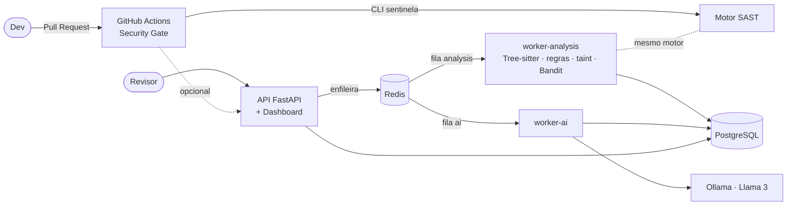
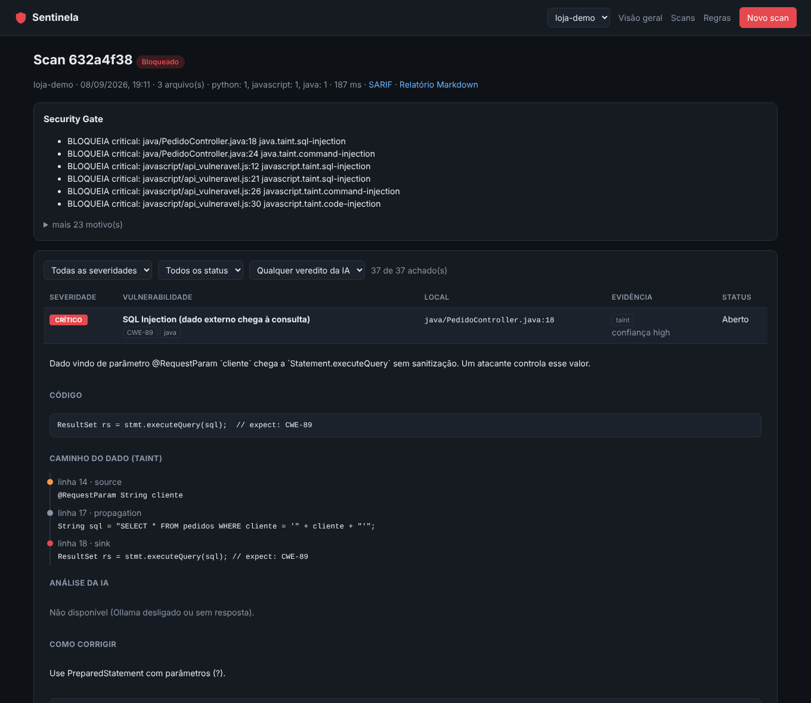

# 🛡️ Sentinela — Plataforma SAST & DevSecOps

> Projeto Integrador · Engenharia de Software (3º ano) · FIAP 2026
> Prof. M.Sc. Oerton Fernandes

O Sentinela analisa código-fonte **sem executá-lo** (SAST) em **Python,
JavaScript e Java**. Ele rastreia o caminho de dados não confiáveis até
funções perigosas (taint analysis) e usa um **LLM local (Llama 3 via Ollama)**
para separar vulnerabilidades reais de falsos positivos e sugerir a correção.
Tudo isso roda dentro do pipeline: um **Security Gate** no GitHub Actions
comenta cada Pull Request e bloqueia o merge quando há evidência forte de
vulnerabilidade.



---

## Sumário

- [Integrantes](#integrantes)
- [Entregáveis e critérios](#entregáveis-e-critérios)
- [Arquitetura](#arquitetura)
- [Como rodar](#como-rodar)
- [Como usar](#como-usar)
- [Motor de análise](#motor-de-análise)
- [IA local](#ia-local)
- [Security Gate](#security-gate)
- [Dashboard e relatórios](#dashboard-e-relatórios)
- [Benchmark](#benchmark)
- [Testes e qualidade](#testes-e-qualidade)
- [Configuração](#configuração)
- [Estrutura do repositório](#estrutura-do-repositório)
- [Limitações conhecidas](#limitações-conhecidas)
- [Ética](#ética)

---

## Integrantes

| Nome | RM |
| --- | --- |
| Guilherme Abe | RM554743 |
| Gustavo Ruiz Vieira Paulino | RM554779 |
| Victor Pacifico Dias | RM558017 |

---

## Entregáveis e critérios

### CP1 — Fundação e parsers

| Entregável | Onde |
| --- | --- |
| Diagrama de arquitetura técnica | [`docs/architecture/c4.md`](docs/architecture/c4.md): contexto, containers, componentes e sequência |
| Repositório com Docker Compose | [`docker-compose.yml`](docker-compose.yml): API, 2 workers, PostgreSQL, Redis e Ollama |
| Parser de código funcional | Tree-sitter para 3 linguagens: [`sentinela/engine/languages/`](sentinela/engine/languages/) |
| Detecção de violações iniciais | Senhas/tokens hardcoded, `eval`, comandos de shell — 26 regras de padrão + 20 sinks de taint em [`sentinela/rules/`](sentinela/rules/) |

### CP2 — IA e análise semântica

| Entregável | Onde |
| --- | --- |
| Módulo de taint analysis | [`sentinela/engine/taint.py`](sentinela/engine/taint.py): fontes → sanitizadores → sinks, com análise entre funções |
| Integração com LLM local | Ollama + Llama 3: [`sentinela/ai/assistant.py`](sentinela/ai/assistant.py) |
| Classificação de severidade e redução de FP | Veredito, confiança e severidade sugerida para cada achado |
| Sugestões de remediação | Código corrigido gerado pela IA, mais exemplo seguro revisado em cada regra |
| Demo de varredura semântica | [`docs/demo.md`](docs/demo.md) e o [benchmark](#benchmark) |

### CP3 — DevSecOps e entrega

| Entregável | Onde |
| --- | --- |
| Plataforma SAST funcional | API, workers, CLI e dashboard; 63 testes automatizados |
| Integração CI/CD com Security Gates | [`.github/workflows/security-gate.yml`](.github/workflows/security-gate.yml) e a action reutilizável [`action.yml`](action.yml) |
| Dashboard e relatórios analíticos | Dashboard web, SARIF 2.1.0, relatório Markdown e JSON |
| Defesa técnica e documentação | Este README, os diagramas C4, 4 ADRs e o [roteiro de demo](docs/demo.md) |

### Como o projeto atende os critérios de avaliação

| Critério | Peso | Evidência |
| --- | ---: | --- |
| Arquitetura | 25% | AST via Tree-sitter com adaptadores por linguagem; API, worker de análise e worker de IA como serviços separados; filas Redis; tudo em Docker |
| Robustez SAST | 30% | Regras declarativas, taint analysis com sanitizadores e análise entre funções, segundo motor (Bandit), fingerprint estável. Benchmark: 100% de recall, contra 59% do Bandit sozinho |
| Inovação IA | 20% | Llama 3 local com contexto de código e caminho do dado; veredito de falso positivo, severidade e correção; segredos mascarados; circuit breaker |
| DevSecOps | 15% | Action reutilizável, comentário automático no PR, SARIF na aba Security, política por repositório, gate baseado em evidência |
| Defesa | 10% | ADRs justificando cada decisão, benchmark reproduzível e limitações declaradas |

---

## Arquitetura



**Como um scan percorre o sistema**

1. A API grava o scan e enfileira a análise.
2. O `worker-analysis` roda o motor e grava os achados.
3. Um *chord* do Celery dispara uma avaliação por achado na fila `ai`.
4. Quando todas terminam, o `finalize` calcula o Security Gate.

O PostgreSQL é o único estado compartilhado, então API e workers escalam
separadamente:

```bash
docker compose up --scale worker-analysis=3 --scale worker-ai=2
```

Os detalhes ficam em [`docs/architecture/c4.md`](docs/architecture/c4.md). As decisões de projeto estão nos ADRs:

- [0001 — Motor multi-linguagem via adaptadores](docs/adr/0001-ir-multilinguagem.md)
- [0002 — IA consultiva](docs/adr/0002-ia-consultiva.md)
- [0003 — Filas separadas](docs/adr/0003-filas-separadas.md)
- [0004 — Gate por evidência forte](docs/adr/0004-evidencia-forte.md)

**Stack:** Python 3.12 · Tree-sitter · Bandit · FastAPI · PostgreSQL 16 ·
SQLAlchemy/Alembic · Redis · Celery · Ollama (Llama 3) · Chart.js · Docker ·
GitHub Actions.

---

## Como rodar

### Docker (stack completa)

```bash
git clone https://github.com/GusRVPaulino/sast-devsecops-fiap.git
cd sast-devsecops-fiap

docker compose up --build                  # sem IA
docker compose --profile ai up --build     # com Ollama + Llama 3 (~4,7 GB na 1ª vez)
```

- **Dashboard:** http://localhost:8000
- **API interativa:** http://localhost:8000/docs
- **Dados de demonstração:** `docker compose exec api python scripts/seed_demo.py`

### Local (sem Docker)

```bash
pip install -e ".[dev]"
sentinela serve                 # API + dashboard em http://localhost:8000 (SQLite, modo inline)
```

---

## Como usar

### CLI

```bash
sentinela scan src/                                   # analisa um diretório
sentinela scan . --diff origin/main                   # só arquivos alterados no PR
sentinela scan . --ai                                 # com triagem por IA (Ollama local)
sentinela scan . --sarif out.sarif --markdown pr.md --json out.json
sentinela scan . --api http://localhost:8000 --project minha-api   # registra no dashboard
```

A saída mostra cada achado com o caminho do dado, e o código de saída segue
o gate:

- **0:** aprovado ou com avisos;
- **1:** bloqueado.

```
CRITICAL java/PedidoController.java:18  SQL Injection (dado externo chega à consulta) (CWE-89)
         ResultSet rs = stmt.executeQuery(sql);
           ↳ linha 14 source: @RequestParam String cliente
           ↳ linha 17 propagation: String sql = "SELECT * FROM pedidos WHERE cliente = '" + cliente + "'";
           ↳ linha 18 sink: ResultSet rs = stmt.executeQuery(sql);

Security Gate: BLOQUEADO
```

### Em qualquer repositório (GitHub Actions)

```yaml
- uses: actions/checkout@v4
  with: { fetch-depth: 0 }
- uses: GusRVPaulino/sast-devsecops-fiap@main
  with:
    diff-base: origin/${{ github.base_ref }}
```

### API

| Método | Endpoint | Para quê |
| --- | --- | --- |
| `POST` | `/api/scans` | Envia arquivos (JSON) para análise |
| `POST` | `/api/scans/upload` | Envia um `.zip` |
| `GET` | `/api/scans/{id}` | Status: `queued` → `analyzing` → `ai_review` → `completed` |
| `GET` | `/api/scans/{id}/findings` | Achados com caminho do dado, IA e correção (filtros: `severity`, `status`, `ai_verdict`) |
| `GET` | `/api/scans/{id}/gate` | Decisão do Security Gate |
| `GET` | `/api/scans/{id}/sarif` | Relatório SARIF 2.1.0 |
| `GET` | `/api/scans/{id}/report.md` | Relatório Markdown |
| `PATCH` | `/api/findings/{id}` | Revisão: `confirmed`, `false_positive`, `accepted_risk`, `fixed` |
| `GET` | `/api/projects/{nome}/metrics` | Dados do dashboard |
| `GET` | `/api/rules` | Catálogo de regras |

---

## Motor de análise

```
arquivo → Tree-sitter → LanguageAdapter → regras YAML ┐
                                        → segredos    ├→ fusão → Bandit → contexto → fingerprint
                                        → taint       ┘
```

### Regras declarativas (26 regras de padrão)

As regras ficam em [`sentinela/rules/{python,javascript,java}.yml`](sentinela/rules/).
Exemplo:

```yaml
- id: python.command.subprocess-shell
  severity: high
  cwe: CWE-78
  match:
    call: ["subprocess.run", "subprocess.Popen", ...]
    kwarg_equals: {shell: "True"}
    arg_not_constant: 0        # comando fixo não é reportado
```

O motor resolve aliases de import (`import subprocess as sp`,
`const { exec } = require("child_process")`). Em Java, ele usa o tipo
declarado da variável: `Statement stmt` faz `stmt.executeQuery` virar
`Statement.executeQuery`.

### Taint analysis (20 sinks nas 3 linguagens)

A especificação fica em [`sentinela/rules/taint.yml`](sentinela/rules/taint.yml).

**Fontes**

| Linguagem | Exemplos |
| --- | --- |
| Python | `request.args`, `request.form`, `input()` |
| JavaScript | `req.query`, `req.body`, `location.hash` |
| Java | `getParameter`, parâmetros `@RequestParam` e `@PathVariable` |

**Sanitizadores** interrompem o fluxo: `int()`, `shlex.quote`, `parseInt`,
`path.basename`, `Integer.parseInt`, `encodeForHTML`...

**Sinks** cobrem SQL Injection, Command Injection, Code Injection, Path
Traversal, SSRF, XSS, Open Redirect e Log Injection.

**Entre funções:** se `buscar(id)` repassa `id` a um `execute`, a chamada
`buscar(req.query.id)` é detectada. Uma função que retorna dado de fonte
também vira fonte.

### Segredos (CWE-798)

O detector funciona em duas frentes:

- **Formato de provedor:** AWS, GitHub, Slack, Stripe, Google, JWT, chave
  privada e URL com senha.
- **Nome + valor:** `password`, `apiKey`, `client_secret`..., com filtro de
  placeholder, entropia mínima e severidade reduzida em arquivos de teste.

O valor **nunca** aparece no relatório: nem no snippet, nem na mensagem, nem
no contexto enviado à IA.

### Bandit como segundo motor

Em arquivos Python, quando o Bandit aponta a mesma linha com CWE compatível,
o achado ganha o motor `bandit`. São duas implementações independentes
concordando, o que conta como evidência forte para o gate.

### Fingerprint

O fingerprint é um hash da regra, do arquivo e do texto normalizado da
linha, sem o número da linha. Inserir código acima não cria um achado
"novo", e a decisão do revisor (falso positivo, risco aceito) continua
valendo.

---

## IA local

Para cada achado, o Llama 3 recebe:

- a regra e a CWE;
- o **caminho do dado**;
- **±8 linhas de código**, com credenciais já mascaradas.

Ele devolve um JSON validado:

```json
{"verdict": "false_positive", "confidence": "high",
 "rationale": "Linha 15 valida `ordem` contra COLUNAS antes da consulta.",
 "suggested_severity": "low",
 "fix_explanation": "...", "fix_code": "..."}
```

**Princípios** ([ADR 0002](docs/adr/0002-ia-consultiva.md)):

- **A IA recomenda, não decide.** Ela não altera status nem o gate.
  Prováveis falsos positivos ficam recolhidos no comentário do PR, e quem
  fecha o achado é um revisor.
- **Respostas reproduzíveis.** As chamadas usam `temperature: 0` e
  `format: json`; respostas fora do esquema são descartadas.
- **Sem Ollama, tudo funciona igual.** A primeira falha de conexão desliga
  a IA pelo resto do scan (circuit breaker).

---

## Security Gate

A política fica em [`.sentinela.yml`](.sentinela.yml), por repositório:

```yaml
gate:
  fail_on: high                 # severidade mínima que pode bloquear
  require_strong_evidence: true
  ignore_paths: ["tests/fixtures/*"]
```

**Evidência forte** é qualquer um destes casos
([ADR 0004](docs/adr/0004-evidencia-forte.md)):

- fluxo de dados comprovado;
- dois motores concordando;
- token em formato de provedor.

Achados com evidência única viram **aviso**. Decisões do revisor removem o
achado do gate; o veredito da IA, não.

**O que o workflow faz em cada PR**

1. Analisa só os arquivos alterados.
2. Comenta no PR e atualiza o mesmo comentário a cada push.
3. Publica o resumo no job.
4. Envia o SARIF para a aba Security.
5. Falha o check se o gate bloquear.

---

## Dashboard e relatórios

- **Visão geral:** KPIs, severidade, tendência de falhas por scan, top 5
  arquivos críticos, OWASP Top 10, CWEs mais frequentes e resultado da
  triagem por IA.
- **Scan:** motivos do gate e lista de achados com filtros (severidade,
  status, veredito da IA). Cada achado expande para mostrar o código, o
  caminho do dado, a análise da IA, a correção e os botões de revisão.
- **Regras:** catálogo completo.
- **Relatórios:** SARIF 2.1.0 (com *code flows* do taint), Markdown e JSON.



O dashboard é HTML e JavaScript puro, com o Chart.js embutido. Funciona sem
internet e escapa todo conteúdo exibido, porque ele mostra código
vulnerável e não pode ser vulnerável a XSS.

---

## Benchmark

O corpus rotulado fica em [`benchmark/corpus/`](benchmark/corpus/). Uma linha
com `# expect: CWE-N` é uma vulnerabilidade real; o resto conta como falso
positivo. Há três tipos de arquivo por linguagem: vulnerável, seguro
parecido e **falso positivo semântico** (código seguro que só uma leitura do
contexto revela).

```bash
python -m benchmark.run_benchmark          # motores determinísticos
python -m benchmark.run_benchmark --ai     # + triagem pelo Llama 3
```

| Configuração | Precisão | Recall | F1 |
| --- | ---: | ---: | ---: |
| Regras de padrão (AST) | 72% | 70% | 0.71 |
| Regras + taint analysis | 76% | **100%** | 0.86 |
| **Sentinela** (regras + taint + Bandit) | **76%** | **100%** | **0.86** |
| Bandit sozinho (só Python) | 59% | 59% | 0.59 |

**Como ler esses números**

- **Taint é o que leva o recall a 100%:** as regras de padrão sozinhas
  perdem 11 das 37 vulnerabilidades.
- **No Python, o Sentinela supera o Bandit:** encontra 17 de 17, contra 10
  de 17.
- **Os falsos positivos restantes são semânticos:** quase todos estão nos
  arquivos `falsos_positivos_semanticos.*`. É o espaço que a triagem por IA
  deve recuperar, e o modo `--ai` mede isso.

O detalhe completo está em [`benchmark/RESULTS.md`](benchmark/RESULTS.md).

> O corpus foi escrito pelo grupo junto com as regras: ele serve como teste
> de regressão, não como prova de generalização. Para uma medida externa,
> rode o motor em projetos open source propositalmente vulneráveis
> (DVWA-like, OWASP NodeGoat, WebGoat) e rotule as falhas conhecidas.

---

## Testes e qualidade

```bash
pytest          # 63 testes
ruff check . && ruff format --check .
```

| Tipo | Cobre |
| --- | --- |
| Unitários | Regras e taint em cada linguagem, sanitizadores, análise entre funções, fusão de motores, fingerprint, segredos (o valor nunca vaza), gate, IA (parsing, circuit breaker, prompt sem segredo), SARIF e Markdown |
| Integração | Fluxo completo da API, revisão que sobrevive a novos scans, upload `.zip` (zip slip e `node_modules`), token da API, pipeline em fila (Celery), CLI e regressão do benchmark |

O workflow de CI ([`ci.yml`](.github/workflows/ci.yml)) roda lint, testes,
benchmark e build da imagem Docker com smoke test.

---

## Configuração

Variáveis de ambiente (prefixo `SENTINELA_`):

| Variável | Padrão | Descrição |
| --- | --- | --- |
| `DATABASE_URL` | `sqlite:///./sentinela.db` | PostgreSQL em produção |
| `EXECUTION_MODE` | `inline` | `queue`: usa Redis e os workers (padrão no Compose) |
| `REDIS_URL` | `redis://localhost:6379/0` | Broker do Celery |
| `AI_ENABLED` | `true` | Liga a triagem por IA |
| `OLLAMA_URL` / `OLLAMA_MODEL` | `http://localhost:11434` / `llama3` | LLM local |
| `OLLAMA_TIMEOUT` | `60` | Segundos por achado |
| `USE_BANDIT` | `true` | Bandit como segundo motor |
| `API_TOKEN` | — | Se definido, escrita na API exige o header `X-API-Token` |
| `MAX_UPLOAD_MB` | `20` | Tamanho máximo do `.zip` |

---

## Estrutura do repositório

```
sentinela/
├── engine/
│   ├── languages/        Tree-sitter + adaptadores (python, javascript, java)
│   ├── rules.py          motor de regras declarativas
│   ├── taint.py          taint analysis + resumo entre funções
│   ├── secrets.py        detector de credenciais
│   ├── external/         Bandit
│   └── scanner.py        orquestração
├── rules/                regras YAML e especificação de taint
├── ai/assistant.py       Ollama / Llama 3
├── gate.py               política e decisão do Security Gate
├── services.py           casos de uso (API, workers e CLI)
├── worker/tasks.py       Celery: filas analysis e ai
├── api/                  FastAPI + dashboard (static/)
├── reporting/            SARIF e Markdown
├── storage/              modelos SQLAlchemy + migrações Alembic
└── cli.py                comando `sentinela`
benchmark/                corpus rotulado + medição
docs/                     C4, ADRs, roteiro de demo, imagens
tests/                    unitários e integração
action.yml                GitHub Action reutilizável
docker-compose.yml        stack completa
```

---

## Limitações conhecidas

- **Taint intraprocedural com um nível entre funções do mesmo arquivo.**
  Fluxos que atravessam arquivos ou passam por atributos de objeto não são
  seguidos.
- **Sem resolução de tipos completa.** Em Python e JS, regras de método
  (`*.execute`) dependem do nome; em Java, do tipo declarado localmente.
- **Bandit só para Python.** JS e Java contam apenas com os motores próprios.
- **Upload de SARIF em repositório privado** exige GitHub Advanced Security;
  sem ele, o relatório fica como artefato do job.
- **Qualidade da IA.** A triagem depende do modelo. O Llama 3 8B erra em
  código longo ou muito indireto, e por isso a IA é apenas consultiva.

---

## Ética

O código analisado nos testes e no benchmark foi escrito pelo grupo
especificamente para isso. Para analisar código de terceiros, use apenas
repositórios próprios, autorizados ou de código aberto.

A IA roda **localmente**: nenhum trecho de código sai da máquina, e
credenciais são mascaradas antes até de chegar ao modelo local.
