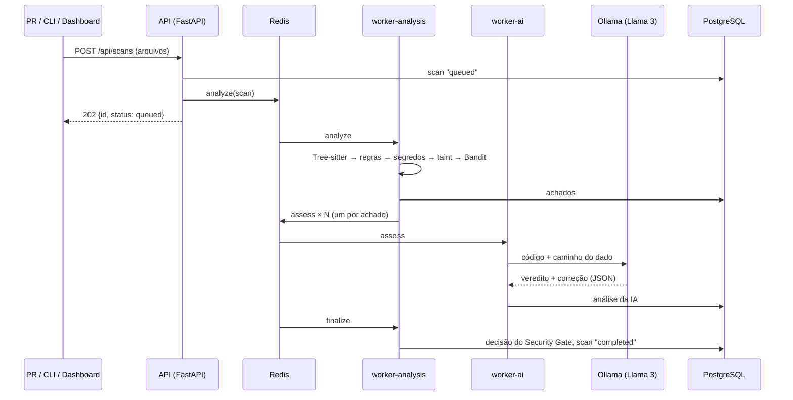

# Sentinela

**Plataforma SAST & DevSecOps.** O Sentinela analisa o código-fonte de cada
Pull Request **sem executá-lo**, em **Python, JavaScript e Java**.

Para cada vulnerabilidade, ele entrega:

- a causa, a evidência e o **caminho do dado** (de onde veio o valor não
  confiável até a função perigosa);
- a correção recomendada, com um exemplo de código seguro.

Uma IA local (Llama 3 via Ollama) revisa cada achado para separar
vulnerabilidades reais de falsos positivos. Um **Security Gate** no GitHub
Actions comenta no PR e bloqueia o merge quando há evidência forte.

> Projeto Integrador · Engenharia de Software (3º ano) · FIAP 2026
> Prof. M.Sc. Oerton Fernandes

| Integrante | RM |
| --- | --- |
| Guilherme Abe | RM554743 |
| Gustavo Ruiz Vieira Paulino | RM554779 |
| Victor Pacifico Dias | RM558017 |

O repositório tem quatro partes:

- **`sentinela/`:** o motor de análise (parsers, regras, taint analysis,
  segredos), a API FastAPI, os workers Celery, o módulo de IA e a CLI.
- **`sentinela/api/static/`:** o dashboard executivo (HTML + JavaScript +
  Chart.js, servido pela própria API).
- **`benchmark/`:** um corpus de código rotulado e o script que mede
  precisão e recall.
- **`.github/workflows/` e `action.yml`:** o Security Gate, que pode ser
  usado neste ou em qualquer outro repositório.

## Screenshots

**Dashboard executivo:** severidade, tendência de falhas por scan, top
arquivos críticos, OWASP Top 10 e resultado da triagem por IA.


**Detalhe de um achado:** caminho do dado (fonte → propagação → sink), análise da IA, correção e botões de revisão.


## Como um scan funciona



A análise determinística e a IA rodam em **filas e workers separados**. A
IA leva segundos por achado e não atrasa a análise de outros PRs, e cada
tipo de worker escala sozinho (`docker compose up --scale worker-ai=3`).

Os diagramas C4 (contexto, containers e componentes) estão em
[`docs/architecture/c4.md`](docs/architecture/c4.md).

## Principais características

- **Uma implementação para três linguagens.** O Tree-sitter gera a AST de
  Python, JavaScript e Java, e um adaptador por linguagem responde às
  mesmas perguntas: qual o nome da chamada, se o argumento é constante,
  qual variável a atribuição define. Regras e taint analysis são escritas
  uma vez sobre esse contrato.
- **Regras declarativas em YAML.** São 26 regras de padrão
  ([`sentinela/rules/`](sentinela/rules/)) e 20 sinks de taint analysis,
  todos mapeados para CWE e OWASP Top 10.
- **Taint analysis com caminho do dado.** Fontes (`request.args`,
  `req.query`, `@RequestParam`...) são rastreadas por atribuições até
  sinks (SQL, shell, `eval`, arquivos, URLs, HTML). Sanitizadores (`int()`,
  `shlex.quote`, `parseInt`, `Integer.parseInt`...) interrompem o fluxo, e
  há análise entre funções do mesmo arquivo.
- **Segredos nunca vazam.** Credenciais detectadas (AWS, GitHub, Stripe,
  JWT, chaves privadas, senhas por nome e entropia) aparecem mascaradas no
  relatório, no banco e no contexto enviado à IA.
- **Bandit como segundo motor.** Em Python, quando o Bandit concorda com um
  achado, ele ganha mais um sinal independente.
- **A IA recomenda, o revisor decide.** O veredito do Llama 3 não muda
  status nem o gate; prováveis falsos positivos só ficam recolhidos no
  comentário do PR. Sem Ollama, tudo funciona igual.
- **O gate só bloqueia com evidência forte.** Bloquear exige fluxo de dados
  comprovado, dois motores concordando ou token em formato de provedor.
  Evidência única vira aviso.
- **Revisão que sobrevive a novos scans.** O fingerprint não usa o número
  da linha. Um achado marcado como falso positivo ou risco aceito continua
  assim mesmo que o código mude de lugar.

## Como rodar

### Docker Compose (stack completa)

```bash
git clone https://github.com/GusRVPaulino/sast-devsecops-fiap.git
cd sast-devsecops-fiap

docker compose up --build                  # API, dashboard, workers, PostgreSQL, Redis
docker compose --profile ai up --build     # + Ollama com Llama 3 (~4,7 GB na 1ª vez)
```

- **Dashboard:** http://localhost:8000
- **Documentação da API:** http://localhost:8000/docs
- **Dados de demonstração:** `docker compose exec api python scripts/seed_demo.py`

### Local, sem Docker

```bash
pip install -e ".[dev]"
sentinela serve          # API + dashboard em http://localhost:8000 (SQLite, sem filas)
```

### Linha de comando

```bash
sentinela scan src/                                  # analisa um diretório
sentinela scan . --diff origin/main                  # só os arquivos alterados
sentinela scan . --ai                                # com triagem pelo Llama 3
sentinela scan . --sarif out.sarif --markdown pr.md  # relatórios
```

O código de saída segue o gate: `0` aprovado, `1` bloqueado.

## Teste de ponta a ponta

```bash
curl -s -X POST localhost:8000/api/scans -H "Content-Type: application/json" -d '{
  "project": "demo",
  "files": [{"path": "app/relatorios.py", "content":
    "from flask import request\ndef relatorio(cursor):\n    cliente = request.args.get(\"cliente\")\n    cursor.execute(f\"SELECT * FROM vendas WHERE cliente = '"'"'{cliente}'"'"'\")\n"}]
}'
# → {"id": "...", "status": "queued", ...}

curl -s localhost:8000/api/scans/<id>             # aguarde status "completed"
curl -s localhost:8000/api/scans/<id>/findings    # achados
curl -s localhost:8000/api/scans/<id>/sarif       # relatório SARIF 2.1.0
```

Este é o comentário real que o Security Gate publicou no
[PR #1](https://github.com/GusRVPaulino/sast-devsecops-fiap/pull/1) (o PR
de demonstração deste repositório), resumido:

```text
⛔ Security Gate: bloqueado
🟥 critical: 1 · 🟨 medium: 1

SQL Injection (dado externo chega à consulta) — exemplos/relatorios.py:17 (CWE-89, confiança high)
Dado vindo de `request.args` chega a `cursor.execute` sem sanitização.

Caminho do dado:
1. linha 14 (source):      cliente = request.args.get("cliente")
2. linha 15 (propagation): consulta = f"SELECT * FROM vendas WHERE cliente = '{cliente}'"
3. linha 17 (sink):        cursor.execute(consulta)

Como corrigir: passe o valor como parâmetro da consulta, nunca interpolado no SQL.
```

## API

| Método | Endpoint | Descrição |
| --- | --- | --- |
| `POST` | `/api/scans` | Envia arquivos (JSON) para análise |
| `POST` | `/api/scans/upload` | Envia um `.zip` |
| `GET` | `/api/scans/{id}` | Status do scan e decisão do gate |
| `GET` | `/api/scans/{id}/findings` | Achados (filtros: `severity`, `status`, `ai_verdict`) |
| `GET` | `/api/scans/{id}/gate` | Decisão do Security Gate e motivos |
| `GET` | `/api/scans/{id}/sarif` | Relatório SARIF 2.1.0 |
| `GET` | `/api/scans/{id}/report.md` | Relatório em Markdown (o mesmo do PR) |
| `PATCH` | `/api/findings/{id}` | Revisão: `confirmed`, `false_positive`, `accepted_risk`, `fixed` |
| `GET` | `/api/projects/{nome}/metrics` | Dados do dashboard |
| `GET` | `/api/rules` | Catálogo de regras |

## Configuração

Variáveis de ambiente (prefixo `SENTINELA_`):

| Variável | Padrão | Descrição |
| --- | --- | --- |
| `DATABASE_URL` | `sqlite:///./sentinela.db` | PostgreSQL no Compose |
| `EXECUTION_MODE` | `inline` | `queue` usa Redis + workers (padrão no Compose) |
| `REDIS_URL` | `redis://localhost:6379/0` | Broker do Celery |
| `AI_ENABLED` | `true` | Triagem por IA |
| `OLLAMA_URL` / `OLLAMA_MODEL` | `http://localhost:11434` / `llama3` | LLM local |
| `USE_BANDIT` | `true` | Bandit como segundo motor |
| `API_TOKEN` | — | Se definido, a escrita na API exige o header `X-API-Token` |

A política do Security Gate fica em [`.sentinela.yml`](.sentinela.yml):

```yaml
gate:
  fail_on: high                  # severidade mínima que pode bloquear
  require_strong_evidence: true  # taint, dois motores ou token de provedor
  ignore_paths: ["tests/fixtures/*"]
```

## Benchmark

O corpus em [`benchmark/corpus/`](benchmark/corpus/) tem 37 vulnerabilidades
rotuladas (`# expect: CWE-N`) nas três linguagens. Para cada linguagem há
três tipos de arquivo: código vulnerável, código seguro parecido e código
seguro que engana as regras.

```bash
python -m benchmark.run_benchmark          # motores determinísticos
python -m benchmark.run_benchmark --ai     # + triagem pelo Llama 3
```

| Configuração | Precisão | Recall | F1 |
| --- | ---: | ---: | ---: |
| Regras de padrão | 72% | 70% | 0.71 |
| Regras + taint analysis | 76% | 100% | 0.86 |
| Sentinela (regras + taint + Bandit) | 76% | 100% | 0.86 |
| Sentinela + triagem por IA (Llama 3 8B) | 77% | 100% | 0.87 |
| Bandit sozinho (só Python) | 59% | 59% | 0.59 |

**O que os números mostram**

- **A taint analysis leva o recall a 100%:** as regras de padrão sozinhas
  perdem 11 das 37 vulnerabilidades.
- **A triagem pelo Llama 3 foi conservadora:** removeu 1 dos 12 falsos
  positivos sem descartar nenhuma vulnerabilidade real.

Os detalhes estão em [`benchmark/RESULTS.md`](benchmark/RESULTS.md) e
[`benchmark/RESULTS-IA.md`](benchmark/RESULTS-IA.md).

## Testes

```bash
pytest                                  # 63 testes: unitários e de integração
ruff check . && ruff format --check .
```

Nenhum teste precisa de PostgreSQL, Redis ou Ollama rodando. O modo fila é
testado com Celery em modo síncrono, e a IA com respostas simuladas.

O CI ([`ci.yml`](.github/workflows/ci.yml)) roda, a cada push:

- lint, testes e benchmark;
- build da imagem Docker;
- a stack completa do `docker-compose`, com um scan de ponta a ponta pela
  API.

## Estrutura do projeto

```
sentinela/
├── engine/
│   ├── languages/     Tree-sitter + adaptadores (python, javascript, java)
│   ├── rules.py       motor de regras declarativas
│   ├── taint.py       taint analysis + análise entre funções
│   ├── secrets.py     detector de credenciais
│   ├── external/      Bandit
│   └── scanner.py     orquestração do scan
├── rules/             regras YAML e especificação de taint
├── ai/assistant.py    integração com Ollama / Llama 3
├── gate.py            política e decisão do Security Gate
├── services.py        casos de uso (usados pela API, workers e CLI)
├── worker/tasks.py    Celery: filas analysis e ai
├── api/               FastAPI + dashboard
├── reporting/         SARIF e Markdown
├── storage/           modelos SQLAlchemy + migrações Alembic
└── cli.py             comando `sentinela`
benchmark/             corpus rotulado + medição de precisão/recall
docs/                  diagramas C4, ADRs, roteiro de demonstração
tests/                 testes unitários e de integração
```

## Decisões de projeto

Cada decisão está registrada em um ADR em [`docs/adr/`](docs/adr/):

1. [Um motor, três linguagens, via adaptadores sobre o Tree-sitter](docs/adr/0001-ir-multilinguagem.md)
2. [A IA recomenda; o gate decide com evidência determinística](docs/adr/0002-ia-consultiva.md)
3. [Duas filas: análise determinística e IA](docs/adr/0003-filas-separadas.md)
4. [O gate só bloqueia com evidência forte](docs/adr/0004-evidencia-forte.md)

## CI: o Security Gate no próprio repositório

O workflow [`security-gate.yml`](.github/workflows/security-gate.yml) usa o
próprio Sentinela em cada Pull Request:

1. Analisa só os arquivos alterados.
2. Publica o resultado como comentário no PR, atualizando o mesmo
   comentário a cada push.
3. Envia o SARIF para a aba **Security** do GitHub.
4. Falha o check quando o gate bloqueia.

A mesma lógica está empacotada como GitHub Action ([`action.yml`](action.yml))
e pode ser usada em outro repositório:

```yaml
- uses: actions/checkout@v4
  with: { fetch-depth: 0 }
- uses: GusRVPaulino/sast-devsecops-fiap@main
  with:
    diff-base: origin/${{ github.base_ref }}
```

## Limitações conhecidas

- **Alcance da taint analysis:** segue o fluxo dentro de cada função e um
  nível entre funções do mesmo arquivo. Fluxos entre arquivos não são
  seguidos.
- **Resolução de tipos:** não há resolução completa. Em Java, o motor usa o
  tipo declarado das variáveis; em Python e JS, regras de método dependem
  do nome.
- **Bandit:** cobre só Python.
- **Qualidade da IA:** depende do modelo. Com o Llama 3 8B, a triagem foi
  conservadora; por isso ela é apenas consultiva.
- **SARIF em repositório privado:** a aba Security exige GitHub Advanced
  Security em repositórios privados. Sem ela, o relatório fica como
  artefato do job.
- **Origem do corpus:** o benchmark foi escrito pelo grupo. Ele serve como
  teste de regressão, não como prova de generalização.

## Ética

O código usado nos testes e no benchmark foi escrito pelo grupo para esse
fim. A IA roda localmente (nenhum código sai da máquina), e credenciais
detectadas são mascaradas antes de chegar ao modelo.
