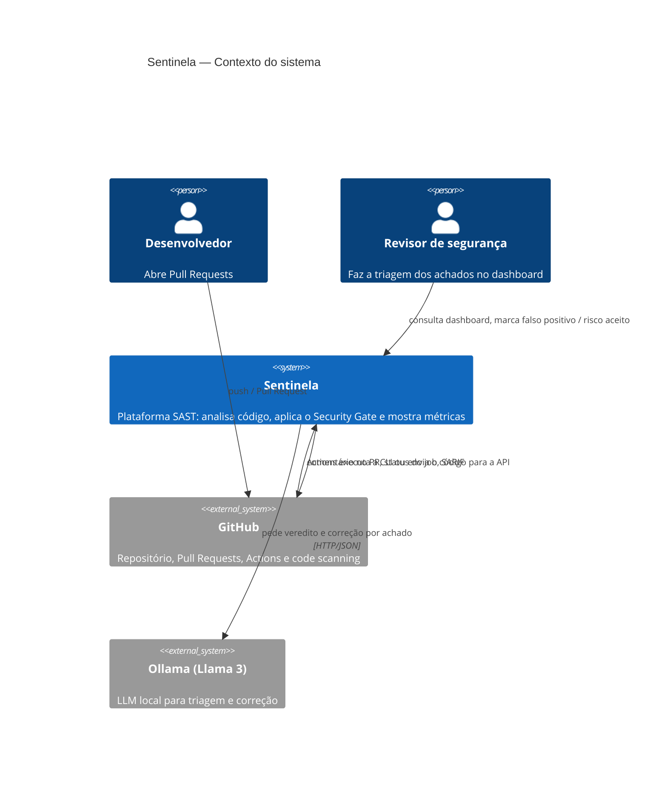
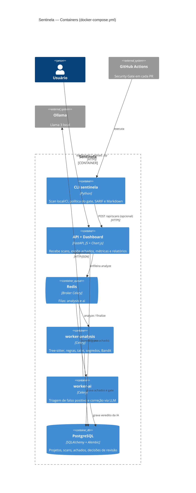
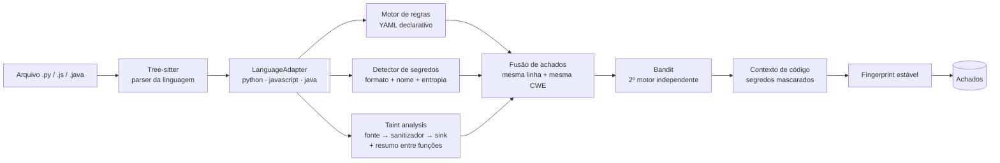
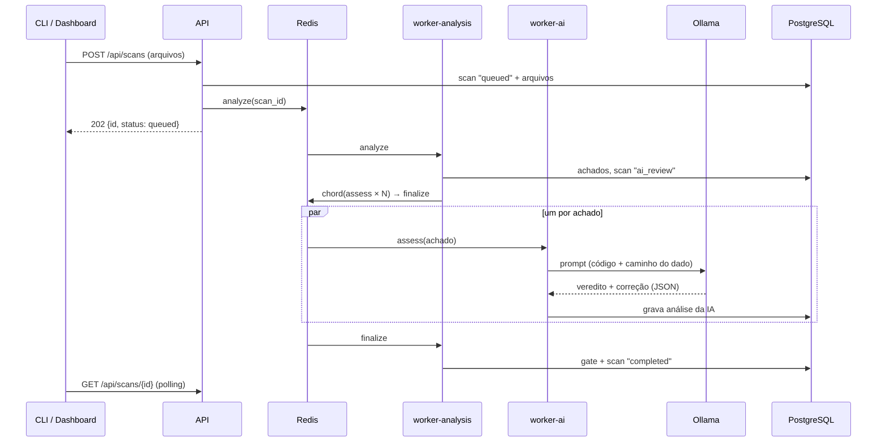

# Arquitetura (Modelo C4)

## Nível 1 — Contexto

## Nível 2 — Containers

## Nível 3 — Componentes do motor de análise

O `LanguageAdapter` é o ponto central do desenho: ele responde, para cada
linguagem, às mesmas perguntas ("qual o nome qualificado desta chamada?",
"este argumento é constante?", "que variável esta atribuição define?").
Regras e taint analysis são escritas **uma vez** sobre esse contrato e
funcionam nas três linguagens. Adicionar uma linguagem é escrever um
adaptador e um arquivo YAML de regras.

## Pipeline assíncrono

